<p align="center">
  <picture>
    <source media="(prefers-color-scheme: dark)" srcset="brand/logo-dark.svg">
    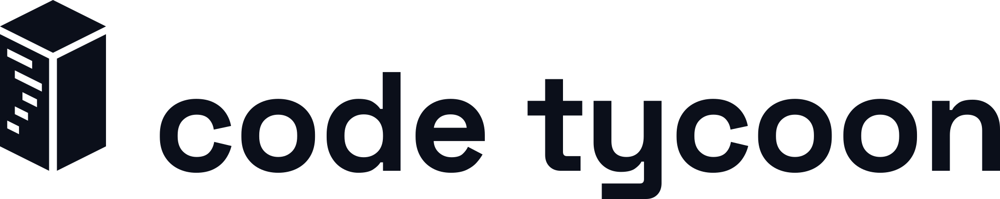
  </picture>
</p>

<p align="center"><b>Know what your project is about, what your Claude Code sessions are doing to it, and what they cost you.</b></p>

<p align="center">
  <code>npx code-tycoon</code> · runs on your machine · free and open source
</p>

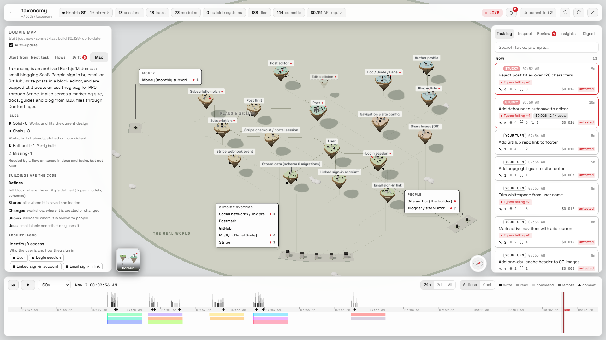

<p align="center">▶ <a href="docs/media/demo-github.mp4"><b>Watch the tour</b></a> (1:40)</p>

## The problem

Claude Code writes code faster than you can read it. That is the point, and it is also how you lose track of your own project.

- **You no longer know what is in the codebase.** A week of sessions adds tables, routes and files you never opened. The picture in your head is a month old, and the folder tree doesn't tell you what the code is *for*.
- **Old design keeps carrying the new one.** Code written for the first version stays, and newer code quietly works around it. Nobody notices until a change breaks something two modules away.
- **Five terminals, no overview.** Which session is waiting for your answer? Which one has failed the type check four times in a row? Which one finished an hour ago?
- **Two sessions, one file.** Parallel sessions edit the same file, and one of them silently drops the other's work.
- **"What did it actually do today?"** By evening there are 40 changed files, a dozen tasks and a bill, and no easy way to see what changed, what was tested and what it cost.
- **You pay for habits you can't see.** Coming back to a session after the cache expired, letting a context grow to 250k tokens, asking Opus a question Sonnet could answer, reading a whole log into context: each one quietly costs dollars, or burns through your plan's usage limits hours early. Nothing tells you which of them you do, or how much they cost.
- **Explaining the project** to a teammate, or to a fresh Claude session, means drawing boxes from memory.

Code Tycoon reads what is already on your disk (your code, its git history, and the Claude Code transcripts in `~/.claude/projects`) and turns it into three live maps of the project, with every session drawn on them as it works. From the token usage in the same transcripts it shows where your money goes and which habits to change to spend less.

| The pain | What Code Tycoon shows |
|---|---|
| Don't know what the project is about anymore | **Domain map**: the things the code deals with (users, posts, subscriptions), how they connect, and the people and systems they serve |
| Old code dragging the new design | **Drift**: each assumption the code was built on that no longer holds, with the evidence, what it costs today and the fix |
| Don't know if a feature really works end to end | **Flows**: walk a user journey isle by isle and file by file, marked works, partial or broken |
| Lost among terminals | **Sessions panel and dashboard**: needs you, stuck, working, your turn, in every project |
| Sessions colliding | **Alerts** the moment two sessions edit the same file or work in the same module |
| No idea what the AI did | **Task log, review tab, digest**: every prompt, the files it changed, whether a test or type check passed after, and its cost |
| The bill keeps climbing, limits hit early | **Working with Claude**: cache hit rate, cold resumes, oversized contexts, pricier models than needed, each with what it cost and the habit that avoids it |
| Not sure your way of working is getting better | **Analytics**: cost per task that reached a commit, rework, prompts that landed against prompts that didn't, rules you keep repeating that belong in CLAUDE.md |
| Can't see the structure | **City and architecture diagram**: districts by role, roads and connectors from real imports |
| Code grew slow and bloated | **Optimize**: a ranked list of fixes for one block or district, applied by a session you can watch, undone in one click |

## Domain map: what the project is about

The city shows the code. The domain map shows what the code is *for*.

Every entity the project deals with is a floating isle: `User`, `Post`, `Subscription`, `Stripe webhook event`. Bridges between isles are their relations, labelled with a verb. The files that implement an entity stand on its isle as small buildings, shaped by what they do for it (defines, stores, changes, shows, uses). Far below lies the real world: the people the project serves, the outside systems it calls (Stripe, GitHub, the database), and the money that moves, each tied up to the isles that stand for it.

The isles show how healthy each part is: cracks and falling rocks where the code is shaky, scaffolding where it is half built, a ghost where something is needed but missing, a red flag where code built for an older setup is still carrying the new one.

| | |
|---|---|
| 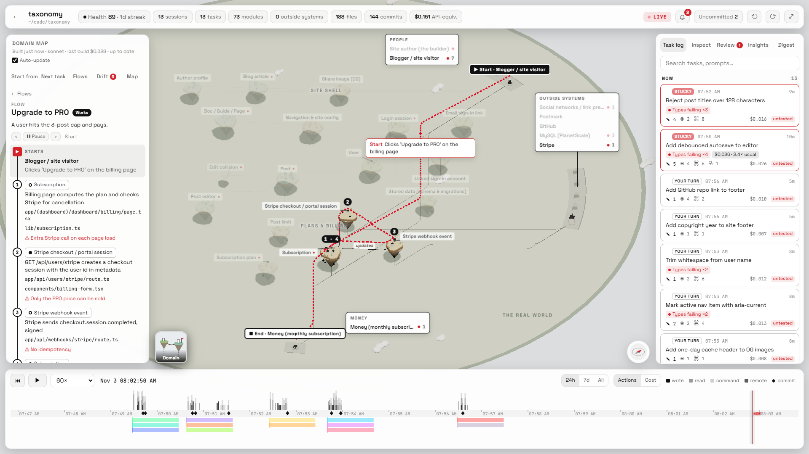 | 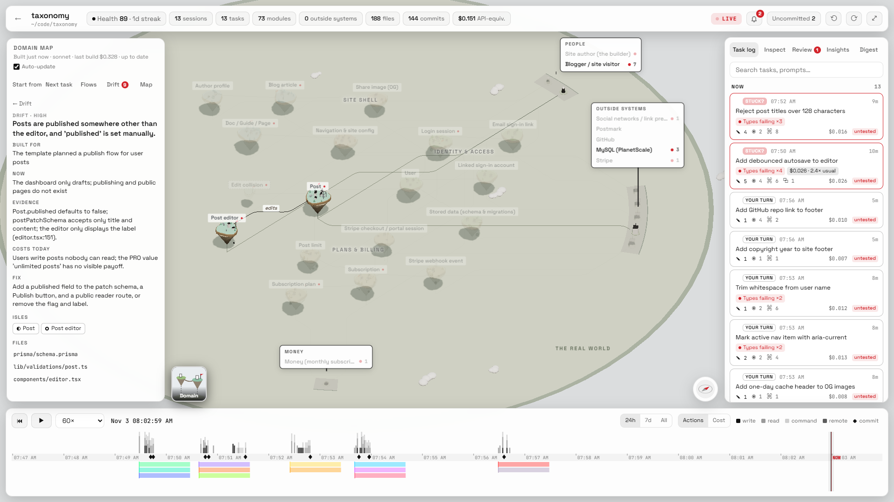 |
| **Flows.** Pick one and a courier walks it from the person who starts it to where the result lands, step by step, with the files at each step and what is fragile there. | **Drift.** Code made for an earlier setup that newer code now works around, ranked by severity, flagged on the isles that carry it. Also: the rules any change must keep. |

- **Start from** the real world: pick a person, system or the money and see the flows it sets going and what is strained around it.
- **Next task**: describe what you want to build next and get a brief of exactly the slice of the project it touches, ready to hand to a Claude Code session.
- **Live**: each session at work hovers over the isle it is touching, in its colour.

The map is built once by Claude Sonnet, through your own Claude Code, with read-only tools (Read, Glob, Grep), from the project folder. It is capped at $10 API-equivalent; the map in these screenshots cost $0.33. After that it **follows your commits**: it updates only when a commit adds, deletes or renames a code file or declares or drops a type, class, table, schema or route. Uncommitted work never triggers it.

## The city: how the code is built

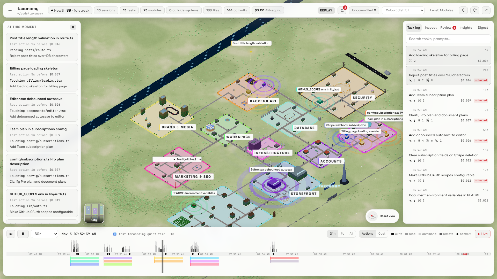

Modules and files are buildings, grouped into districts by what they do (database, payments, auth, UI, API) rather than where they sit in the folder tree. Roads are real imports. Building height is size and commit churn. Data stores, outside systems and local folders are places on the same map.

Every Claude Code session is a drone flying over it: a read is a scan beam, a write throws sparks, a command puffs smoke, a call to an outside system sends a packet to it. Subagents are small drones tethered to their parent.

| | |
|---|---|
| 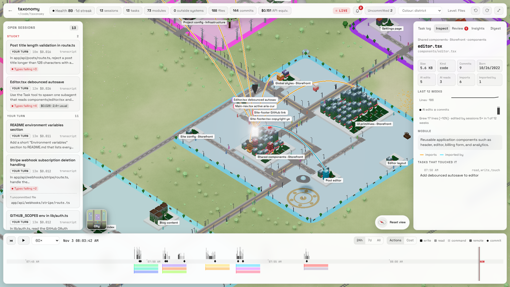 | 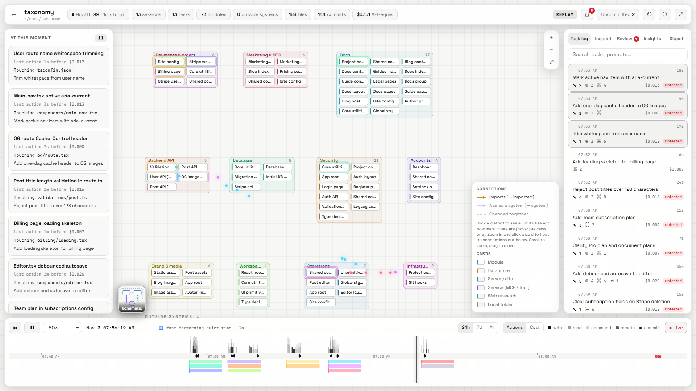 |
| **Inspect.** Zoom in for one building per file. Click one for its imports, commits, the tasks that touched it and an AI-written description. | **Architecture diagram.** The same map as boxes and connectors, drawn by metro-map rules. Each session lights up the modules it reads and changes. |

### Optimize a block or district

Select a block or a district and press **Survey for optimizations**. The model your sessions in that project use reads its busiest files (the ones imported most, changed most and edited most by AI) and follows calls in and out with read-only tools. It returns a short ranked list of what is worth changing: work repeated in hot paths, N+1 queries, blocking I/O on request or render paths, needless re-renders, missing caches, oversized payloads, extra network or model calls, duplicated or dead code. Each item names its files, the gain (speed, memory, size, I/O, cost, simpler), its impact and its risk, and explains what the code does now and exactly what to change. Style nits and speculative rewrites are left out, and "nothing worth changing" is a valid answer.

Nothing changes until you tick items and press **Apply**. A real Claude Code session then makes the edits in the project folder, so you watch it work in the city and the collision alerts cover it. It keeps behavior and public interfaces, adds no dependencies and skips any item that turns out unsafe, saying why. If another session is editing those files right now, you are asked first. The files are snapshotted before the run, so **Undo** puts them back in one click, but never over an edit made after it.

## Watch your sessions work

| | |
|---|---|
| 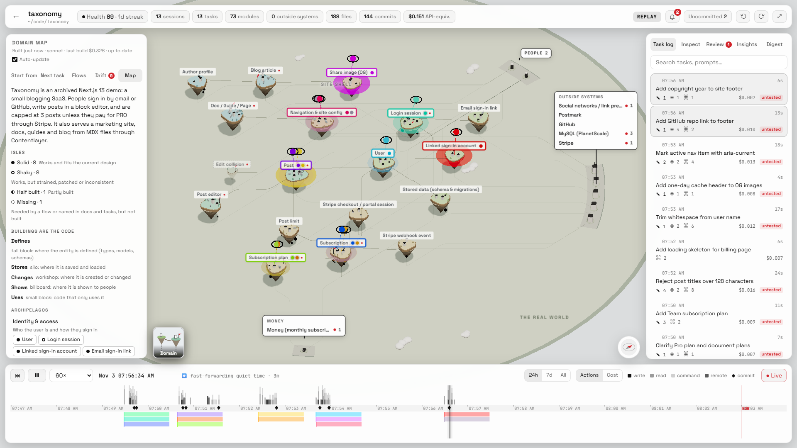 | 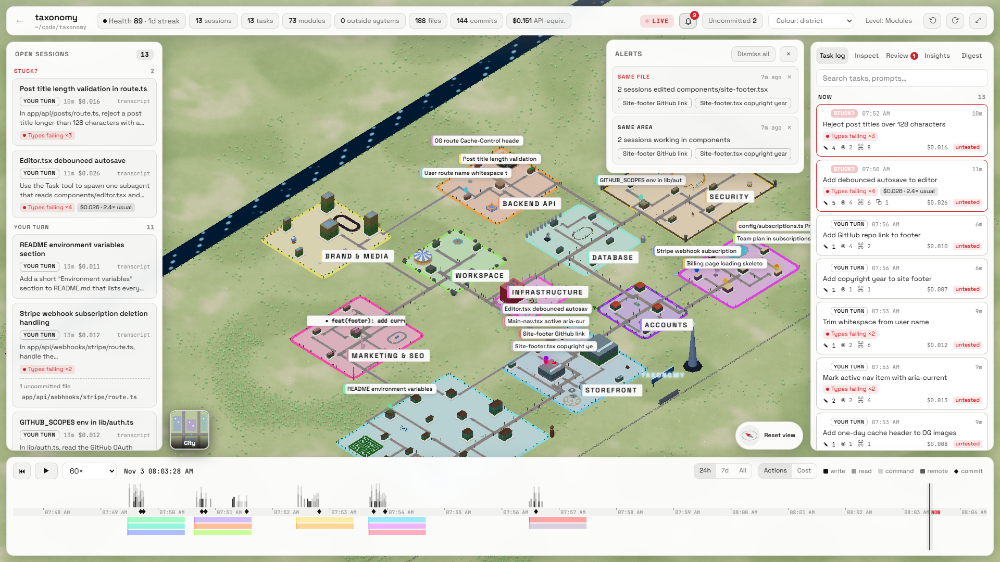 |
| **On the domain map.** Each session hovers over the entity it is working on, so you see which parts of the product are changing right now, not just which files. | **Alerts.** Two sessions on one file, two sessions in one module, a session that needs your answer. Desktop notifications while the tab is in the background. |

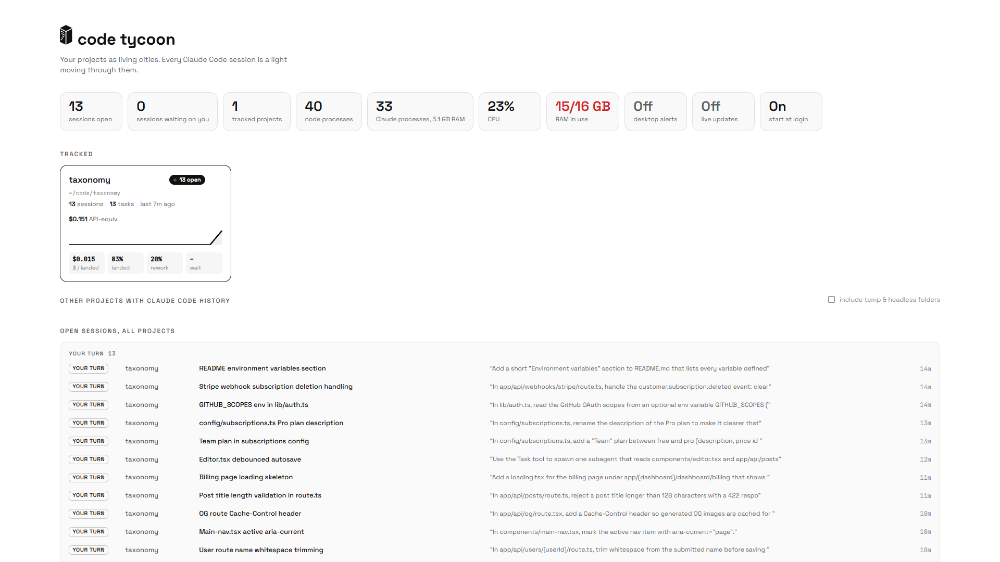

**Dashboard.** Every open session in every project, waiting ones first, with the machine's Claude processes, CPU and RAM.

- **Sessions panel**: needs you / stuck / working / your turn / idle, longest wait first. A session is marked *Stuck?* when it keeps failing the same check, goes in circles, or runs far longer than its usual task.
- **Uncommitted markers** over files with uncommitted changes, in the colour of the session that wrote them. The **Review** tab lists them, riskiest first.
- **Untested** badge on any task that wrote code without a passing test, type check or build afterwards.

## Analytics: spend less, work better with Claude

Every API call in a transcript carries its token usage: what was sent, written to the prompt cache, read from it, and which model answered. Code Tycoon prices each call and works out where the money went and which of your habits wasted it. Amounts are at API list prices. On a Pro or Max plan you are not billed per token, but the same tokens count against your usage limits, so the same habits make you hit them sooner.


**Working with Claude** (on the dashboard, for all projects or one, over the last 7 or 30 days) opens with the numbers that matter: spend, cache hit rate, money lost to cold resumes, the share of calls made in oversized sessions, compactions, how many tokens every turn carries before you type a word, and how much could have been saved. Below them, **the habits that cost you the most**, ranked by dollars:

| Habit | What it catches |
|---|---|
| Cold resume | Coming back after the prompt cache expired, so the whole context is written again. Shows what a fresh session with a short handoff would have cost instead. |
| Large context | Turns that re-read more than 150k tokens of context, every time. |
| New topic, old session | A task in a part of the code the session never touched, still carrying all the earlier work through every call. |
| Auto-compacted | Sessions that ran into the limit and threw away history they had paid to carry. |
| Model switched, cache rebuilt | The cache written again mid-session because the model, tools, MCP servers or settings changed. |
| Pricier model than needed | Read-only tasks (questions, lookups, reviews) run on Opus that Sonnet would have answered for less. |
| Bulky tool output | Whole files and long logs read into context and re-read on every later turn. |
| Heavy start | A starting context bloated by MCP servers, tool definitions, CLAUDE.md and memory. |

Click a habit for every time it happened: the session, the prompts involved, what went wrong and the cheaper way, each with its price. Then the steps that keep it from happening again. Open a session for its context size over time, with compactions, cold resumes and cache rebuilds marked on the curve.

**While you work**, the same checks raise alerts: you just returned to a session whose cache expired (and what a fresh one would cost), a session is carrying a big context, a session moved to a new topic, a session compacted itself, a task has cost four times your usual one.

**Is it getting better?** Each project on the dashboard shows this week against last on four numbers:

- **Cost per landed task**: spend divided by the tasks whose edits reached a commit, so abandoned work counts against it.
- **Landed**: the share of writing tasks that made it into a commit.
- **Rework**: the share of edits another task rewrote within three days.
- **Wait**: how long a finished turn sat waiting for your next prompt.

**Insights** (per project) go after the causes:

- **Prompt → outcome**: your cheapest prompts that landed next to the ones that were abandoned or reworked, and what tells them apart (length, whether they name files).
- **Rules for CLAUDE.md**: corrections you keep typing ("don't…", "always…", "use X instead") that your CLAUDE.md doesn't cover yet, ready to paste in.
- **Rewritten again and again**, **growing fast**, untested code, and dependencies added per week, each linked to the task behind it.
- **Cost** per task, session and project, in the task log and the daily digest, plus a 0–100 project health score.

## Look back

| | |
|---|---|
| 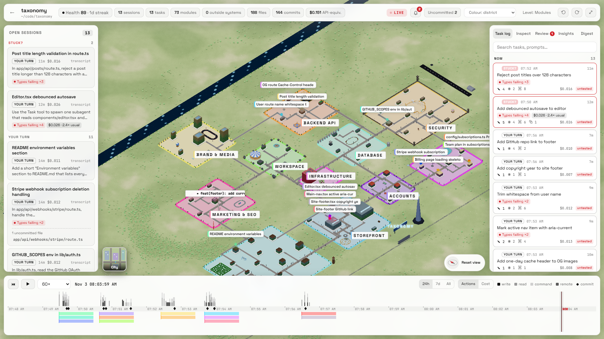 | 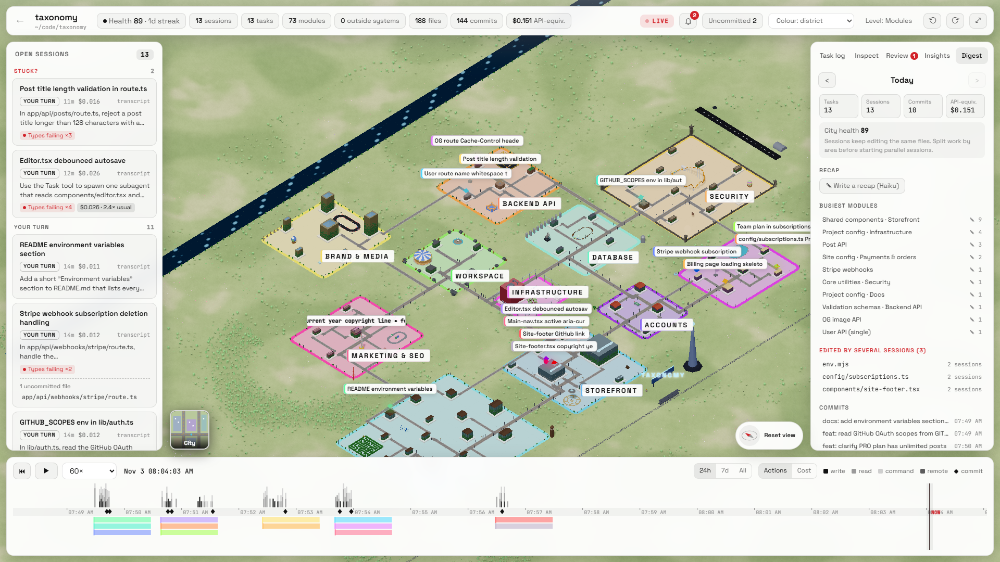 |
| **Task log.** One entry per prompt, with a short AI-written title and everything that task changed, read, ran, called and cost. | **Daily digest.** Tasks, sessions, commits, busiest modules, files edited by several sessions, new connections between parts, and an optional written recap. |

- **Replay from the first commit**: the city starts on empty ground and every file, module, road and label appears when it was born. Up to 7200×, quiet stretches skipped.
- **Timeline**: activity histogram, one lane per session, git commits as landmarks, nights shaded.

The screenshots show [shadcn-ui/taxonomy](https://github.com/shadcn-ui/taxonomy), an open-source Next.js app, after a dozen real Claude Code sessions. The analytics screenshot is Code Tycoon's own repo instead, where a month of real sessions gives the habits something to find.

## Install

```
npx code-tycoon                  # opens http://127.0.0.1:4400
```

The page then offers to turn on live updates and start at login, one click each. Pick a project on the dashboard to track it; the first index of a large history takes a minute. Needs Node 22.13+ and a project you have used Claude Code in.

**Not a terminal person?** Paste this into Claude Code and it does the rest:

> Install Code Tycoon for me. Check that Node.js 22.13 or newer is installed (install or update it if not, and tell me if I need to restart anything), then run `npx -y code-tycoon` in the background so it keeps running, and tell me to open http://127.0.0.1:4400 and click "Turn on" in the "Finish setting up" box.

### Requirements

- Node 22.13 or newer (uses the built-in `node:sqlite`)
- Claude Code, with some sessions already run (transcripts in `~/.claude/projects`). OpenAI Codex CLI sessions (`~/.codex/sessions`, or `$CODEX_HOME/sessions`) are picked up too and tagged "Codex"; they update from the session file a second or two behind, and their cost shows as $0 since only Claude prices are known.
- `git` on PATH for commits, churn, uncommitted-file markers and domain map updates
- The `claude` CLI for the domain map, task briefs, AI task titles and recaps. It is found on PATH or inside the VS Code extension; set `VISUALIZER_CLAUDE` to point at it otherwise. Everything else works without it.
- Windows, macOS or Linux (autostart on Linux needs a systemd user session).

### Commands

```
npx code-tycoon                      # http://127.0.0.1:4400, opens the browser
npx code-tycoon hooks install        # instant live updates; backs up ~/.claude/settings.json first
                                     # (an HTTP hook with a token header; VISUALIZER_HOOK=command for the old node hook)
npx code-tycoon hooks uninstall      # removes them again
npx code-tycoon autostart install    # start hidden at every login (copies the app to ~/.visualizer/app)
npx code-tycoon autostart uninstall
```

Hooks and autostart are also the "live updates" and "start at login" switches on the dashboard. Without hooks the live view still works from transcript tailing, a second or two behind. A second copy started while one is running exits quietly. `VISUALIZER_PORT` changes the port.

### From source

```
npm install
npm run build
npm start                # http://127.0.0.1:4400
npm run hooks:install
```

`npm run dev` runs the API and Vite with hot reload (http://127.0.0.1:5173).
`npm run autostart:install` starts the server hidden at every login from this checkout (logs to `~/.visualizer/server.log`): a Startup-folder launcher on Windows, a LaunchAgent on macOS, a systemd user service on Linux. `npm run autostart:uninstall` removes it. Run through npx, autostart copies the app to `~/.visualizer/app` instead, since npm may clear its cache, and a newer `npx code-tycoon` refreshes that copy.

## Privacy and how it works

Everything is read locally from `~/.claude/projects/*/*.jsonl` (plus `subagents/`) and `~/.codex/sessions/**/rollout-*.jsonl`, parsed incrementally into `~/.visualizer/visualizer.db`. There is no Code Tycoon server and no account.

The only things that leave the machine go through your own `claude` CLI, to the Anthropic API you already use with Claude Code, with no session saved and no hooks fired:

- **Task titles and recaps**: batched prompts to Haiku, no tools. Key-shaped strings in prompts are masked before they are stored or sent. `VISUALIZER_NO_LLM=1` turns this off.
- **The domain map and task briefs**, only when you click build or ask for a brief: Sonnet for the map, and for briefs the model your latest session in that project used, reads the project folder with read-only tools, under a spending cap ($10 per build, $2 per brief; `VISUALIZER_DOMAIN_USD`, `VISUALIZER_BRIEF_USD`). Auto-update can be switched off per project.
- **Optimize**, only when you press survey or apply: the model your latest session in that project used (`VISUALIZER_OPTIMIZE_MODEL` overrides it). The survey reads with read-only tools under a $2 cap, and applying edits only files in the project folder, runs no commands and stops at $8 (`VISUALIZER_OPTIMIZE_SURVEY_USD`, `VISUALIZER_OPTIMIZE_APPLY_USD`).

The server only answers requests from this machine's own pages (Host and Origin are checked), and `/hook` needs the token in `~/.visualizer/token`, so another website open in the browser cannot read your prompts or post fake activity.

The hook installer also sets `cleanupPeriodDays` to 3650 so Claude Code stops deleting transcripts after 30 days; the database keeps everything it has already indexed either way.

## Checks

- `npx tsc --noEmit -p .`: type check (Vite's build does not)
- `PID=<project path> node scripts/probe.mjs probe-out [--full-replay]`: screenshots at 1280 and 1920, fps, console errors, full-history replay (needs Chrome installed)
- `node scripts/live-test.mjs <git repo>`: two real sessions edit one file; expects the collision alert

## License

[AGPL-3.0](LICENSE). You can use, change and share it freely. If you run a modified version as a service for other people, you must publish your changes under the same license.

Code Tycoon is an independent project, not made or endorsed by Anthropic. Claude and Claude Code are trademarks of Anthropic.
