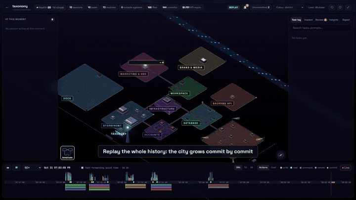
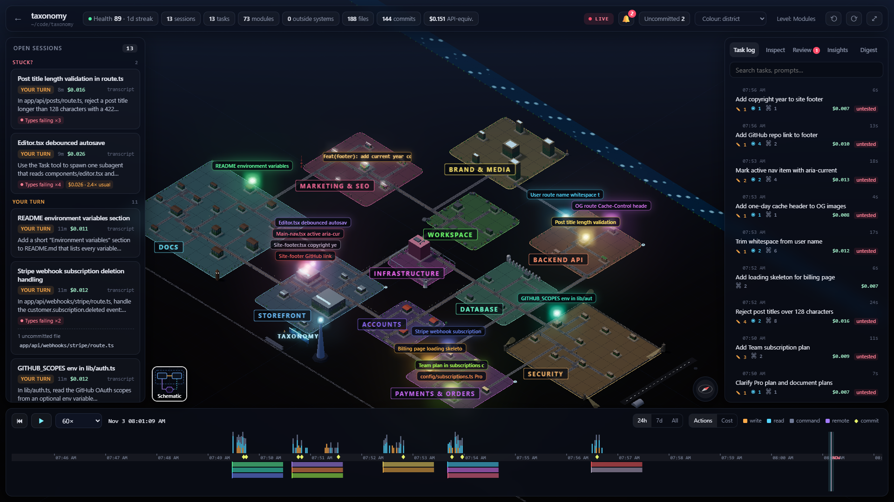
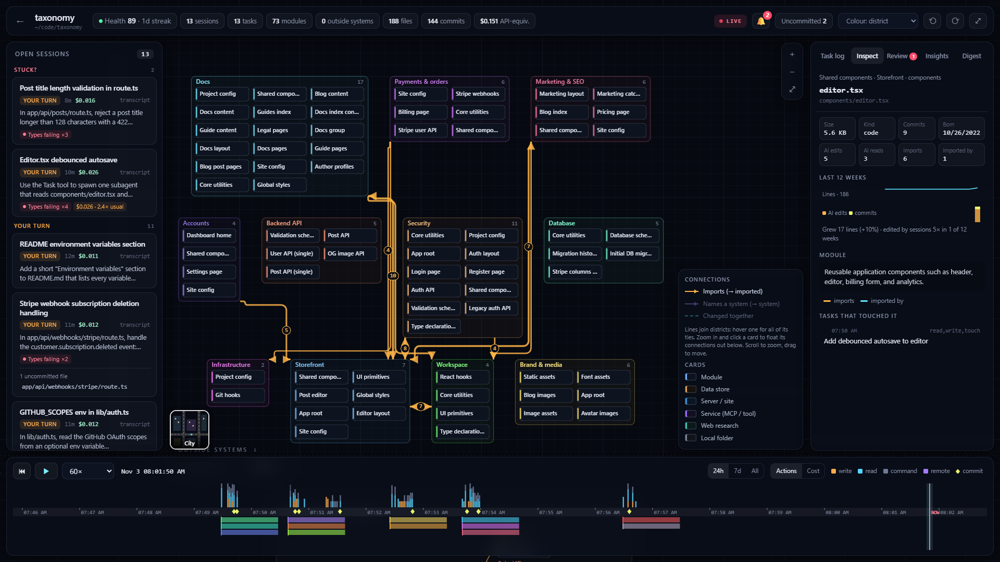
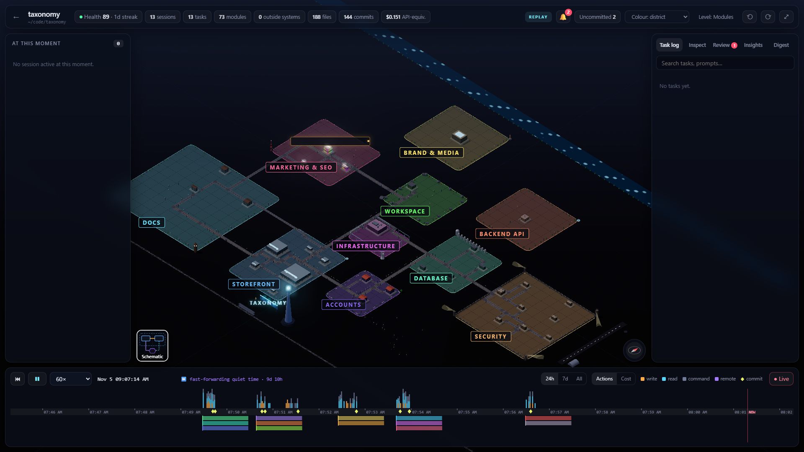
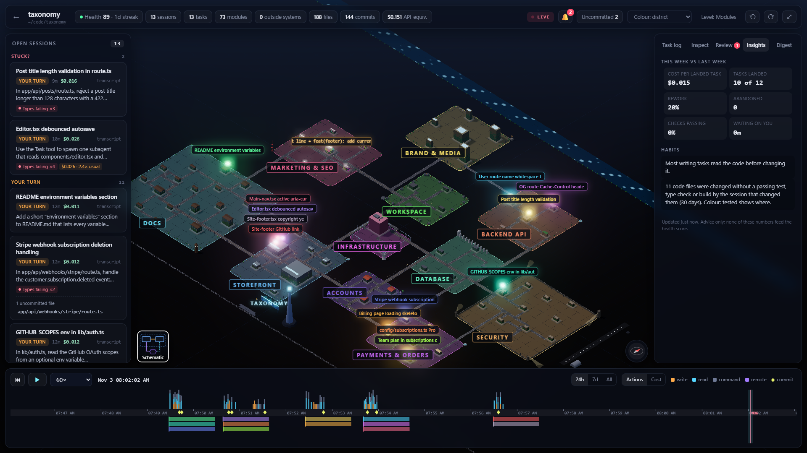

<p align="center">
  <picture>
    <source media="(prefers-color-scheme: dark)" srcset="brand/logo-dark.svg">
    
  </picture>
</p>

<p align="center"><b>See your codebase as a living city, and watch your Claude Code sessions build it.</b></p>

<p align="center">
  <code>npx code-tycoon</code> · runs on your machine · nothing leaves it
</p>

<p align="center"></p>

https://github.com/user-attachments/assets/d40ab430-f911-4285-996f-9debb3273ddc


Code Tycoon is the easiest way to view and explore a project. Point it at a repo you work on with Claude Code and, a minute later, you get a 3D isometric city of it. Every district is a part of the system (database, payments, auth, UI, API), every building is a module or a file, and roads are the real dependencies between them. You see the architecture at a glance, without reading the folder tree or drawing a diagram by hand.

The city is live. Every Claude Code session is a drone flying over it: you watch it read, write, run commands and call outside systems as it happens, and you get an alert when two sessions edit the same file. Rewind the timeline and the city grows from empty ground, commit by commit, to what it is today.

```
npx code-tycoon                  # opens http://127.0.0.1:4400
```

The page then offers to turn on live updates and start at login, one click each. Needs Node 22.13+ and a project you have used Claude Code in. Everything runs and stays on your machine.

**Not a terminal person?** Paste this into Claude Code and it does the rest:

> Install Code Tycoon for me. Check that Node.js 22.13 or newer is installed (install or update it if not, and tell me if I need to restart anything), then run `npx -y code-tycoon` in the background so it keeps running, and tell me to open http://127.0.0.1:4400 and click "Turn on" in the "Finish setting up" box.

## Screenshots

| | |
|---|---|
|  |  |
| **The city.** Districts are what each part does, not where it sits in the folder tree. | **Sessions at work.** One drone per session, live or replayed. |
|  |  |
| **Zoom in and click.** Files, imports, history and the tasks that touched them. | **Architecture diagram.** The same map as boxes and connectors. |
|  |  |
| **Task log.** Every prompt you gave, titled, with what it changed, read and ran. | **Alerts.** Two sessions on one file, or a session waiting for you. |
|  |  |
| **Replay.** The city grows from empty ground, commit by commit. | **Insights.** What landed, rework, habits, and rules worth adding to CLAUDE.md. |
|  |  |
| **Daily digest.** Tasks, commits, busiest modules, files several sessions touched. | **Overview.** Every open session in every project, waiting ones first. |

The screenshots show [shadcn-ui/taxonomy](https://github.com/shadcn-ui/taxonomy), an open-source Next.js app, after a dozen real Claude Code sessions. ▶ [Watch the full one-minute video](docs/media/demo.mp4).

## Why

- **Understand a codebase fast.** New to a repo, or back after a month? The city shows its parts, their size, how they connect and where the work happens, in one picture.
- **See the architecture as it really is.** Districts and roads come from imports, files changed together, and the systems the code talks to, so the map matches the code, not an old diagram.
- **Know what your AI sessions are doing.** Several Claude Code sessions at once stop being a pile of terminal tabs: you see where each one is working, which one is waiting for you, and when two collide.
- **Look back.** Replay a day, a week or the whole history and see what was built, by which task, and what it cost.

## Features

**Explore the project**
- **City of the architecture**: modules, data stores, outside systems (APIs, sites, MCP services) and local folders are places on one map. Connected places stand together, groups form named districts, roads join them. Building height is size and commit churn.
- **Districts by role**: database, payments, auth, UI, API and so on, each with its own look and its own properties (tables and migrations for a database, providers and currencies for payments).
- **Zoom levels**: zoom out for one building per module, in for one per file.
- **Inspect**: click a building for its imports, commits, the tasks that touched it and an AI-written description.
- **Architecture diagram**: switch the city to a schematic of boxes and connectors.
- **Colour modes**: by district, recent edits, churn, or the last session that wrote each file.
- **Arrange it**: drag areas and buildings where you want them; the layout is remembered.

**Watch Claude Code work**
- **Sessions are drones**, one colour each. A read is a scan beam, a write throws sparks, a command puffs smoke, a remote call sends a packet to that system. Subagents are small drones tethered to their parent.
- **Sessions panel**: needs you / working / your turn / idle, longest wait first, with the uncommitted files each session wrote.
- **Alerts**: two sessions editing the same file, two sessions in the same module, a session that needs your answer. Desktop notifications while the tab is in the background.
- **Overview**: every open session in every project on one page, waiting ones first.
- **Uncommitted markers** over files with uncommitted changes, in the colour of the session that wrote them.

**Look back**
- **Replay from the start**: the city begins on empty ground and every file, module, road and label appears when it was born. Play at up to 7200×; quiet stretches are skipped.
- **Timeline**: activity histogram, one lane per session, git commits as landmarks, nights shaded.
- **Task log**: one entry per prompt, with a short AI-written title and everything that task changed, read, ran and called.
- **Daily digest**: tasks, sessions, commits, busiest modules, files edited by several sessions, new connections between parts, and an optional written recap.
- **Insights and health**: what landed, rework, tasks waiting on you, hotspots, and a 0–100 project health score.
- **Cost**: API-equivalent cost per task, session and project from the token usage in the transcripts.

## Use cases

- **Onboarding onto a new codebase**: open the city and see the system's parts and how they connect before reading any code.
- **Running several Claude Code sessions in parallel**: keep track of who works where, answer the one that is waiting, and catch two sessions editing the same file before their changes clash.
- **Reviewing what AI did today**: the digest and task log show every task, the files it changed and the commit it produced, so nothing slips in unreviewed.
- **Explaining a project to someone else**: share your screen on the city or the architecture diagram instead of drawing boxes on a whiteboard.
- **Finding hotspots and tech debt**: churn colours, rework and collisions show which parts keep changing and keep causing trouble.
- **Watching cost**: see which tasks, sessions and parts of the code cost the most.
- **Telling the story of a project**: replay it from the first commit for a demo, a retro or a post.

## Requirements

- Node 22.13 or newer (uses the built-in `node:sqlite`)
- Claude Code, with some sessions already run (transcripts in `~/.claude/projects`). OpenAI Codex CLI sessions (`~/.codex/sessions`, or `$CODEX_HOME/sessions`) are picked up too and tagged "Codex"; they update from the session file a second or two behind, and their cost shows as $0 since only Claude prices are known.
- `git` on PATH for commits, churn and uncommitted-file markers
- Optional: the `claude` CLI for AI task titles and recaps. It is found on PATH or inside the VS Code extension; set `VISUALIZER_CLAUDE` to point at it otherwise.
- Windows, macOS or Linux (autostart on Linux needs a systemd user session).

## Run

```
npx code-tycoon                  # http://127.0.0.1:4400, opens the browser
npx code-tycoon hooks install    # instant live updates; backs up ~/.claude/settings.json first
                                 # (an HTTP hook with a token header; VISUALIZER_HOOK=command for the old node hook)
npx code-tycoon hooks uninstall  # removes them again
npx code-tycoon autostart install    # start hidden at every login (copies the app to ~/.visualizer/app)
npx code-tycoon autostart uninstall
```

Both are also the "live updates" and "start at login" switches on the overview.

Pick a project on the overview to track it; the first index of a large history takes a minute.
Without hooks the live view still works from transcript tailing, a second or two behind.
A second copy started while one is running exits quietly. `VISUALIZER_PORT` changes the port.

### From source

```
npm install
npm run build
npm start                # http://127.0.0.1:4400
npm run hooks:install
```

`npm run dev` runs the API and Vite with hot reload (http://127.0.0.1:5173).
`npm run autostart:install` starts the server hidden at every login from this checkout (logs to `~/.visualizer/server.log`): a Startup-folder launcher on Windows, a LaunchAgent on macOS, a systemd user service on Linux. `npm run autostart:uninstall` removes it. Run through npx, autostart copies the app to `~/.visualizer/app` instead, since npm may clear its cache, and a newer `npx code-tycoon` refreshes that copy.

## Privacy and how it works

The server only answers requests from this machine's own pages (Host and Origin are checked), and `/hook` needs the token in `~/.visualizer/token`, so another website open in the browser cannot read your prompts or post fake activity.

Everything is read locally from `~/.claude/projects/*/*.jsonl` (plus `subagents/`) and `~/.codex/sessions/**/rollout-*.jsonl`, parsed incrementally into `~/.visualizer/visualizer.db`. Nothing leaves the machine except the batched task-title requests, which go through your own `claude -p` (Haiku, no tools, no session saved, no hooks). Key-shaped strings in prompts are masked before they are stored or sent. Set `VISUALIZER_NO_LLM=1` to turn titling off.

The installer also sets `cleanupPeriodDays` to 3650 so Claude Code stops deleting transcripts after 30 days; the database keeps everything it has already indexed either way.

## Checks

- `npx tsc --noEmit -p .` — type check (Vite's build does not)
- `PID=<project path> node scripts/probe.mjs probe-out [--full-replay]` — screenshots at 1280 and 1920, fps, console errors, full-history replay (needs Chrome installed)
- `node scripts/live-test.mjs <git repo>` — two real sessions edit one file; expects the collision alert

## License

[AGPL-3.0](LICENSE). You can use, change and share it freely. If you run a modified version as a service for other people, you must publish your changes under the same license.

Code Tycoon is an independent project, not made or endorsed by Anthropic. Claude and Claude Code are trademarks of Anthropic.
